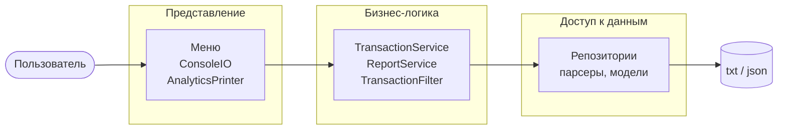

<div align="center">


<h1>Transaction Analyzer</h1>

<p><b>Консольный анализатор финансовых транзакций на Java 21</b></p>

<p><i>«Тысячи транзакций — одна понятная картина.»</i></p>

<p>


</p>

<p>
<a href="#о-проекте">О проекте</a> ·
<a href="#быстрый-старт">Быстрый старт</a> ·
<a href="#возможности">Возможности</a> ·
<a href="#как-пользоваться">Как пользоваться</a> ·
<a href="#формат-данных">Формат данных</a> ·
<a href="#архитектура">Архитектура</a> ·
<a href="#тестирование">Тестирование</a>
</p>

</div>

---

## О проекте

Выписка из банка — это сотни строк, в которых сложно увидеть главное: сколько ушло на еду за квартал, какой месяц был самым дорогим, сколько в итоге принёс сберегательный счёт. **Transaction Analyzer** читает счета и транзакции из текстовых файлов и за пару шагов в консольном меню превращает их в понятную аналитику: фильтрует, группирует, считает и сохраняет отчёт в JSON.

Проект написан как финальная работа курса «Продвинутый Java Core» и показывает на практике ООП, Stream API, обобщения, работу с файлами, собственную иерархию исключений и трёхзвенную архитектуру.

| | |
|---|---|
| **Тип** | Консольное приложение для аналитики транзакций |
| **Язык** | Java 21 |
| **Сборка** | Gradle Wrapper |
| **Данные** | Текстовые файлы со счетами и транзакциями |
| **Отчёт** | Консоль и JSON |
| **Разработчик** | Piperite Games |

## Быстрый старт

> Нужен только **JDK 21**. Gradle ставить не требуется — проект собирается через Gradle Wrapper.

1. Склонируйте репозиторий:
   ```bash
   git clone https://github.com/KyomuTenshi/Transaction-Analyzer.git
   cd Transaction-Analyzer
   ```
2. Запустите приложение, передав файл счетов, файл транзакций и имя JSON-файла для отчёта:
   ```bash
   ./gradlew run --args="accounts.txt transactions.txt analytics.json"
   ```

Для расширенного набора данных замените `transactions.txt` на `transactions-extended.txt`.

<details>
<summary><b>Запуск из IntelliJ IDEA</b></summary>
<br>

1. Откройте папку проекта — IDEA сама подхватит Gradle.
2. Создайте конфигурацию **Application** с главным классом `com.piperitegames.finance.Application`.
3. В **Program arguments** укажите `accounts.txt transactions.txt analytics.json`.

</details>

## Возможности

- **Пять типов транзакций.** Обычные, налогооблагаемые, валютные, повторяющиеся и с комментариями. Каждая сама знает свою реальную сумму: налог вычитается, валюта переводится по курсу.
- **Гибкий поиск.** Фильтры по категории, диапазону дат, сумме и тексту комментария. Повторяющаяся транзакция попадает в выборку, если хотя бы один её повтор приходится на нужный период.
- **Группировка.** По месяцам, годам, дню недели, категории, типу счёта, ID пользователя, на доходы и расходы — или без группировки.
- **Агрегация.** Сумма, среднее и количество. Деньги хранятся в `BigDecimal` и округляются по стандартным правилам.
- **Отчёт в JSON.** Последний расчёт сохраняется в файл вместе с датой, фильтрами и выбранной функцией.
- **Понятные ошибки.** Если в файле битая строка, приложение покажет имя файла, номер строки и причину. Неверный ввод в меню не роняет приложение.

## Как пользоваться

Работа с приложением — это цикл из четырёх шагов в главном меню:

| Шаг | Пункт меню | Что происходит |
|:---:|---|---|
| 1 | `1` — критерии поиска | Задаёте фильтры; по умолчанию берутся все транзакции |
| 2 | `2` — поле для группировки | Выбираете, по какому признаку разбить результат |
| 3 | `3` — функция агрегации | Сумма, среднее или количество |
| 4 | `4` / `5` — расчёт и сохранение | Аналитика выводится в консоль и при желании сохраняется в JSON |

```text
Анализ финансов
0 — выход из приложения
1 — задать критерии поиска транзакций
2 — выбрать поле для группировки
3 — выбрать функцию агрегации
4 — рассчитать и вывести аналитику
5 — сохранить аналитику
Введите нужную опцию и нажмите Enter.
> 4
===================================
Дата: 2026-10-25 20:14:37
Расчёт: группировка по категории (подсчёт суммы)
Фильтр: начальная дата — 2020-01-01, конечная дата — 2021-05-11, минимальная сумма — -40, максимальная сумма — 1000
-----------------------------------
Аналитика:
  Food: -25.50
  Salary: 90.00
  Transport: -15.00
===================================
```

<details>
<summary><b>Пример сохранённого отчёта</b></summary>
<br>

```json
{
  "date" : "2026-10-25T20:14:37",
  "groupOption" : "группировка по категории",
  "aggregateOption" : "подсчёт суммы",
  "filter" : "начальная дата — 2020-01-01, конечная дата — 2021-05-11, минимальная сумма — -40, максимальная сумма — 1000",
  "data" : {
    "Food" : -25.50,
    "Salary" : 90.00,
    "Transport" : -15.00
  }
}
```

</details>

## Формат данных

Оба файла — обычный текст: одна запись на строку, поля через запятую. Пустые строки и комментарии с `#` пропускаются.

**Счета** — `ID счёта, тип счёта, ID пользователя`. Тип: `0` — текущий, `1` — сберегательный, `2` — кредитный.

```text
10001,0,1
10002,1,1
10003,2,2
```

**Транзакции** — `ID счёта, ID транзакции, дата и время, категория, сумма, тип, дополнительные поля`.

```text
10001,2,2020-01-01T12:00:00,Food,-25.50,Regular,
10002,8,2020-04-15T14:15:00,Salary,5000.00,Taxable,0.20
10001,6,2020-03-22T19:00:00,Entertainment,-45.00,ForeignCurrency,85
10001,16,2020-03-22T19:00:00,Subscription,-9.99,Recurrent,monthly;7
10003,22,2023-06-01T09:00:00,Books,-30.00,Commentable,Bought a book;Gift
```

<details>
<summary><b>Как считается сумма для каждого типа</b></summary>
<br>

| Тип | Дополнительные поля | Реальная сумма |
|---|---|---|
| `Regular` | — | Как в файле |
| `Taxable` | Ставка налога, `0.20` | За вычетом налога: 5000 → 4000 |
| `ForeignCurrency` | Курс к базовой валюте, `85` | Сумма × курс: −45 → −3825 |
| `Recurrent` | Паттерн и число повторов, `monthly;7` | Как в файле, одно выполнение |
| `Commentable` | Комментарии через `;` | Как в файле |

</details>

В репозитории два набора данных: `transactions.txt` повторяет пример из задания, а `transactions-extended.txt` добавляет повторяющиеся транзакции, комментарии и транзакцию с несуществующим счётом.

## Архитектура

Приложение разделено на три слоя. Каждый слой знает только о своём соседе и общается с ним через интерфейсы, поэтому файловое хранилище можно заменить базой данных, не трогая меню и бизнес-логику.



| Слой | Ответственность |
|---|---|
| `controller/` | Консольные меню, ввод и вывод; работает только с сервисами и ничего не знает о файлах |
| `service/` | Фильтрация, группировка, агрегация и подготовка отчёта |
| `data/` | Модели, разбор строк файлов, чтение данных и запись JSON |
| `exception/` | Собственные исключения для каждой бизнес-ошибки |
| `Application` | Точка входа: создаёт реализации всех слоёв и связывает их |

**Ключевые решения**

- Расчёт аналитики — один стрим: фильтр → функция группировки → коллектор агрегации.
- Тип транзакции сам считает свою сумму и даты выполнения, поэтому в коде нет `switch` по типам.
- Фильтр неизменяемый и проверяет диапазоны ещё при создании.
- Ошибка в данных останавливает загрузку с точным адресом строки, а не даёт молча неверный результат.

<details>
<summary><b>Структура проекта</b></summary>
<br>

```text
src/main/java/com/piperitegames/finance/
├── Application.java            # точка входа и сборка зависимостей
├── controller/                 # консольные меню, ввод и вывод
│   └── option/                 # пункты меню
├── service/                    # бизнес-логика
│   ├── analytics/              # группировка, агрегация, результат
│   └── filter/                 # фильтр транзакций
├── data/
│   ├── model/                  # счета, транзакции, отчёт
│   ├── parser/                 # разбор строк файлов
│   └── repository/             # интерфейсы хранилищ
│       └── file/               # файловые реализации и запись JSON
└── exception/                  # собственные исключения
```

</details>

## Тестирование

```bash
./gradlew test
```

| Набор | Что проверяет |
|---|---|
| `TransactionParserTest` | Разбор всех типов транзакций, налог и курс, повторы, запятые в комментариях, ошибки формата |
| `TransactionFilterTest` | Категория, даты с учётом повторов, сумма после налога, поиск по комментарию, неверные диапазоны |
| `DefaultTransactionServiceTest` | Все группировки и функции агрегации на данных из задания, фильтры, пустой результат |

## Стек

| | |
|---|---|
| **Язык** | Java 21 |
| **Сборка** | Gradle Wrapper |
| **JSON** | Jackson 2.17.2 (`jackson-databind`, `jackson-datatype-jsr310`) |
| **Шаблонный код** | Lombok 1.18.34 |
| **Тесты** | JUnit 5.10.3 |

Остальные зависимости — в [`build.gradle`](build.gradle).

---

<div align="center">
<sub>Сделано <a href="https://github.com/KyomuTenshi">KyomuTenshi</a> · Piperite Games</sub>
</div>
